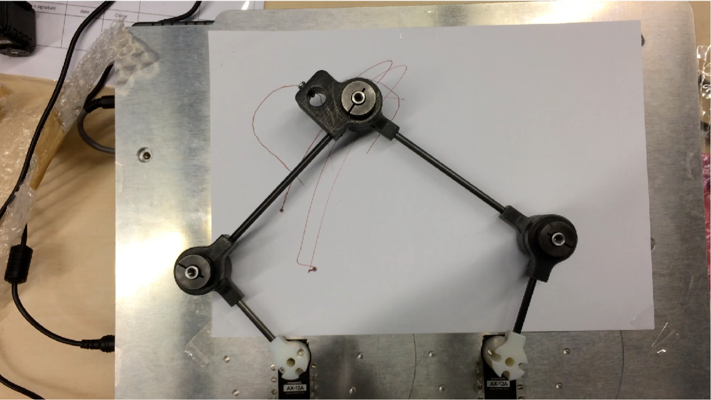

################################################################
 Système 5 barres de dessin robotisé avec Raspberry Pi et ROS 2
################################################################

   Le pantographe (système 5 barres) utilisé pour le projet.

Ce projet porte sur un pantographe, aussi appelé système 5 barres : un mécanisme
plan à deux bras motorisés qui déplace un crayon pour dessiner sur une feuille.
Notre objectif est de le faire fonctionner avec ROS 2 sur un Raspberry Pi 5,
de le simuler, et de documenter l'ensemble de la démarche.

.. note::

   Le point de départ de cette documentation (structure des pages, modèle 3D, schéma
   cinématique) est le canevas fourni par M. Manuel YGUEL dans le cours
   `Informatique industrielle avec ROS2 <https://yguel.github.io/informatique_industrielle_avec_ROS2/>`_.

=====================
Démarche du projet
=====================

Nous avons découpé le travail en onze étapes :

#. décrire la plateforme mécanique ;
#. décrire le matériel électronique (Raspberry Pi, carte et moteurs Dynamixel), avec les liens vers les documentations techniques ;
#. créer la représentation du système 5 barres dans un fichier URDF ;
#. visualiser ce modèle dans RViz ;
#. établir le modèle du mécanisme et les équations qui permettent de piloter la position du crayon ;
#. créer un package ROS 2 pour commander le système 5 barres ;
#. écrire et documenter des tests ;
#. écrire un programme qui fait dessiner le système 5 barres ;
#. tester sur le système réel ;
#. écrire un code de simulation ;
#. tester en simulation avec Gazebo et RViz.

Chacune de ces étapes est détaillée dans les pages suivantes.

.. toctree::
   :maxdepth: 2

   p50s01_material_description
   p50s02_mechanical_description
   p50s03_urdf
   p50s04_kinematics