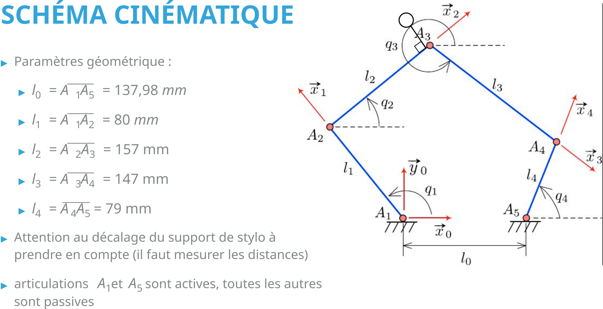
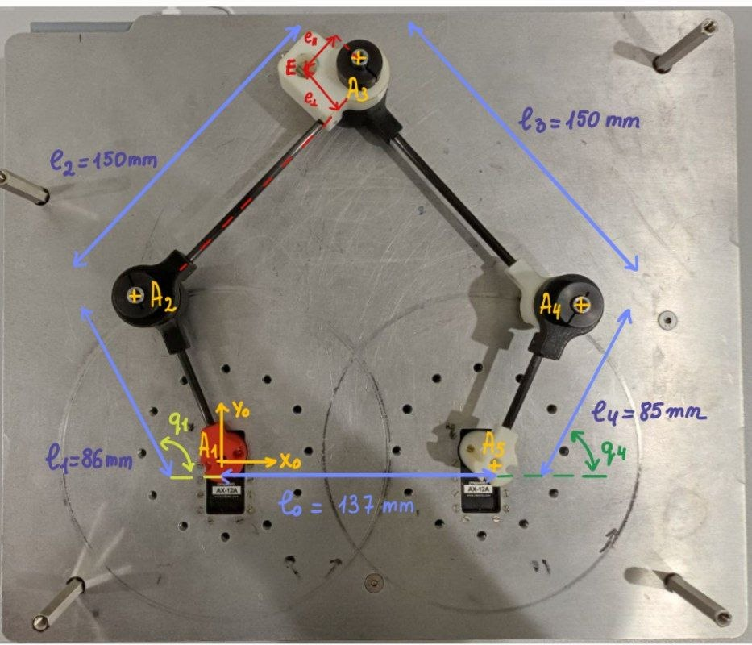

.. _mechanical_description:

#########################################################
 Description mécanique de la plateforme système 5 barres
#########################################################

Le système 5 barres est une chaîne cinématique fermée et plane. Deux bras sont
entraînés chacun par un moteur fixé sur le bâti ; leurs extrémités sont reliées
par deux avant-bras, qui se rejoignent au niveau de l'organe terminal porte-crayon.
En faisant tourner les deux moteurs, on déplace le crayon dans le plan de la feuille.

   Schéma cinématique du système 5 barres (source : cours de M. YGUEL).

Les deux moteurs sont placés en :math:`A_1` et :math:`A_5` : ce sont les
**articulations actives**. Les articulations :math:`A_2`, :math:`A_3` et
:math:`A_4` sont **passives**.

   La plateforme réelle, annotée avec nos notations et nos dimensions mesurées.

Dimensions mesurées
===================

Nous avons mesuré les longueurs des barres directement sur la plateforme, entre
les centres des pivots. Elles diffèrent légèrement des valeurs du modèle 3D du
cours : ce sont nos valeurs mesurées qui servent de référence pour le pilotage du
robot réel.

.. list-table::
   :header-rows: 1
   :widths: 15 35 20 20

   * - Symbole
     - Grandeur
     - Valeur mesurée
     - Valeur du modèle 3D
   * - :math:`l_0`
     - entraxe des moteurs :math:`A_1A_5`
     - 137 mm
     - 137,98 mm
   * - :math:`l_1`
     - bras gauche :math:`A_1A_2`
     - 86 mm
     - 80 mm
   * - :math:`l_2`
     - avant-bras gauche :math:`A_2A_3`
     - 150 mm
     - 157 mm
   * - :math:`l_3`
     - avant-bras droit :math:`A_3A_4`
     - 150 mm
     - 147 mm
   * - :math:`l_4`
     - bras droit :math:`A_4A_5`
     - 85 mm
     - 79 mm

Position du crayon
==================

Le porte-crayon est fixé sur l'avant-bras gauche (*link2*). Le crayon n'est donc
pas exactement en :math:`A_3`. Mesuré depuis :math:`A_2`, le long de
:math:`\overrightarrow{A_2A_3}`, il se trouve à 134 mm, et il est décalé
latéralement de 26 mm. Par rapport à :math:`A_3`, cela donne :

* :math:`e_\parallel = 134 - l_2 = -16` mm (le crayon est en deçà de :math:`A_3`) ;
* :math:`e_\perp = 26` mm.

Ces valeurs sont utilisées dans les :ref:`modèles géométriques <kinematics>`.

.. note::

   Reste à compléter au prochain accès au robot : la hauteur de la pointe du
   crayon, la présence éventuelle d'un mécanisme de levée du crayon, les butées
   mécaniques des deux bras et la position de la zone de dessin dans le repère.

Liaisons
========

Toutes les liaisons entre les barres sont des liaisons **pivot** d'axe
perpendiculaire au plan de travail. Le mécanisme possède deux degrés de liberté,
correspondant aux deux moteurs.
