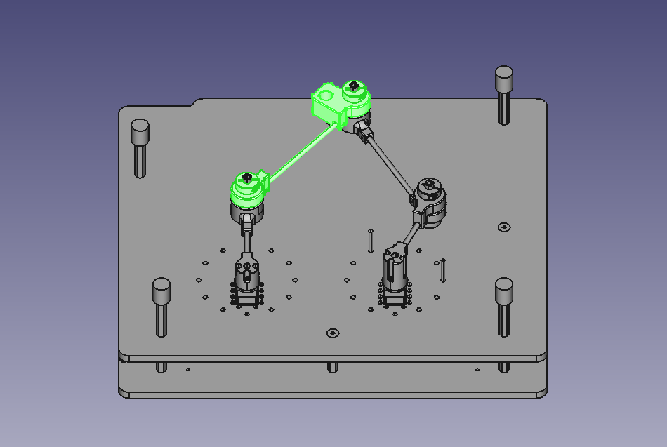

.. _urdf:

#########################################################
 Génération de la description URDF du système 5 barres
#########################################################

Pour visualiser et simuler le système 5 barres avec ROS 2, nous avons besoin de le décrire
dans un fichier URDF (*Unified Robot Description Format*) : la liste de ses pièces
(*links*), des liaisons entre elles (*joints*) et de leurs modèles 3D.

Nous partons du modèle 3D au format STEP conçu et réalisé par M. Olivier PICCIN.

   Modèle 3D de l'assemblage.

Pièces de l'assemblage
======================

L'assemblage comporte cinq pièces principales. Dans l'URDF, nous leur donnons les noms suivants :

.. list-table::
   :header-rows: 1

   * - Pièce dans le modèle 3D
     - Nom dans l'URDF
     - Rôle
   * - BATI_ASM
     - ``base``
     - le bâti, qui porte les deux moteurs
   * - LINK1_ASM
     - ``link1``
     - le bras gauche
   * - LINK2_ASM
     - ``link2``
     - l'avant-bras gauche
   * - LINK3_ASM
     - ``link3``
     - l'avant-bras droit
   * - LINK4_ASM
     - ``link4``
     - le bras droit

Modèle complet : `maquette-5-barres_asm.stp <https://github.com/yguel/informatique_industrielle_avec_ROS2/raw/rolling/doc/sphinx/source/p00_5_bars_system_pencil_holder_with_rpi_and_dynamixel/resources/cad/maquette-5-barres_asm.stp>`__

L'outil de travail, le crayon, doit aussi apparaître dans l'URDF. Son support est fixé
sur l'avant-bras gauche (``link2``) : c'est donc par rapport à cette pièce que nous le positionnons.

Un fichier URDF utilise des modèles 3D au format COLLADA (extension ``.dae``).
Il faut donc découper l'assemblage STEP en cinq pièces, puis convertir chacune en COLLADA.

Extraction des pièces au format STEP
====================================

Les pièces peuvent être extraites de l'assemblage avec le logiciel FreeCAD :

#. `base.stp <https://github.com/yguel/informatique_industrielle_avec_ROS2/raw/rolling/doc/sphinx/source/p00_5_bars_system_pencil_holder_with_rpi_and_dynamixel/resources/cad/base.stp>`__
#. `link1.stp <https://github.com/yguel/informatique_industrielle_avec_ROS2/raw/rolling/doc/sphinx/source/p00_5_bars_system_pencil_holder_with_rpi_and_dynamixel/resources/cad/link1.stp>`__
#. `link2.stp <https://github.com/yguel/informatique_industrielle_avec_ROS2/raw/rolling/doc/sphinx/source/p00_5_bars_system_pencil_holder_with_rpi_and_dynamixel/resources/cad/link2.stp>`__
#. `link3.stp <https://github.com/yguel/informatique_industrielle_avec_ROS2/raw/rolling/doc/sphinx/source/p00_5_bars_system_pencil_holder_with_rpi_and_dynamixel/resources/cad/link3.stp>`__
#. `link4.stp <https://github.com/yguel/informatique_industrielle_avec_ROS2/raw/rolling/doc/sphinx/source/p00_5_bars_system_pencil_holder_with_rpi_and_dynamixel/resources/cad/link4.stp>`__

Conversion des pièces au format COLLADA
=======================================

La conversion en COLLADA peut également se faire avec FreeCAD :

#. `base.dae <https://github.com/yguel/informatique_industrielle_avec_ROS2/raw/rolling/doc/sphinx/source/p00_5_bars_system_pencil_holder_with_rpi_and_dynamixel/resources/cad/base.dae>`__
#. `link1.dae <https://github.com/yguel/informatique_industrielle_avec_ROS2/raw/rolling/doc/sphinx/source/p00_5_bars_system_pencil_holder_with_rpi_and_dynamixel/resources/cad/link1.dae>`__
#. `link2.dae <https://github.com/yguel/informatique_industrielle_avec_ROS2/raw/rolling/doc/sphinx/source/p00_5_bars_system_pencil_holder_with_rpi_and_dynamixel/resources/cad/link2.dae>`__
#. `link3.dae <https://github.com/yguel/informatique_industrielle_avec_ROS2/raw/rolling/doc/sphinx/source/p00_5_bars_system_pencil_holder_with_rpi_and_dynamixel/resources/cad/link3.dae>`__
#. `link4.dae <https://github.com/yguel/informatique_industrielle_avec_ROS2/raw/rolling/doc/sphinx/source/p00_5_bars_system_pencil_holder_with_rpi_and_dynamixel/resources/cad/link4.dae>`__

Création du fichier URDF
========================

Dans le fichier URDF, chaque modèle 3D est référencé par une balise ``<mesh>``.

.. à compléter
