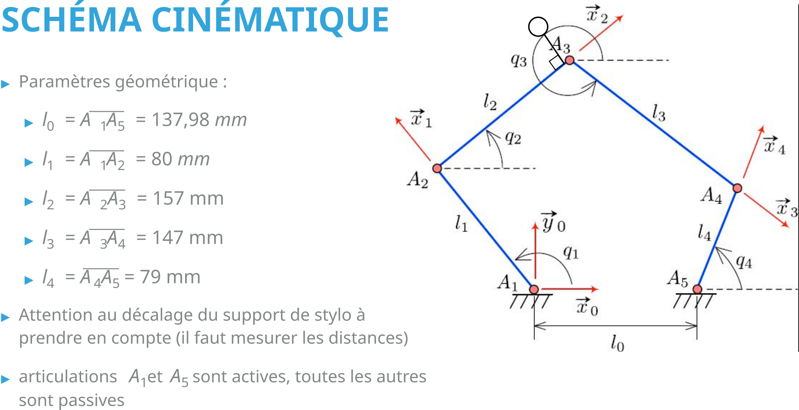

.. _kinematics:

############################################################
 Modèles géométriques direct et inverse du système 5 barres
############################################################

Pour piloter le crayon, il faut savoir passer des angles des moteurs à la position du crayon
(**modèle géométrique direct**, MGD), et surtout de la position voulue du crayon aux angles
à donner aux moteurs (**modèle géométrique inverse**, MGI).
Cette page établit ces deux modèles, puis décrit l'espace de travail et les singularités du mécanisme.

Notations
=========

   Schéma cinématique du système 5 barres et notations.

Nous reprenons les notations du schéma cinématique :

* le repère :math:`(A_1, \vec{x}_0, \vec{y}_0)` a pour origine l'axe du moteur gauche,
  :math:`\vec{x}_0` est dirigé vers l'axe du moteur droit, :math:`\vec{y}_0` vers le haut ;
* :math:`A_1 = (0, 0)` et :math:`A_5 = (l_0, 0)` sont les axes des deux moteurs ;
* :math:`l_1 = A_1A_2`, :math:`l_2 = A_2A_3`, :math:`l_3 = A_3A_4` et :math:`l_4 = A_4A_5` sont les longueurs des barres,
  mesurées entre les centres des pivots ;
* :math:`q_1` est l'angle de :math:`\overrightarrow{A_1A_2}` et :math:`q_4` celui de :math:`\overrightarrow{A_5A_4}` :
  ce sont les deux **articulations actives**, commandées par les moteurs ;
* :math:`q_2` est l'angle de :math:`\overrightarrow{A_2A_3}` : c'est une articulation **passive**.

.. important::

   Tous les angles sont **absolus** : ils sont mesurés depuis l'axe :math:`\vec{x}_0`,
   dans le sens trigonométrique, et non entre deux barres voisines.

Le crayon n'est pas exactement en :math:`A_3` : son support est fixé sur l'avant-bras gauche (*link2*).
Nous notons :math:`E` la pointe du crayon, décalée de :math:`e_\parallel` dans la direction
:math:`\overrightarrow{A_2A_3}` et de :math:`e_\perp` perpendiculairement à celle-ci.

Outil commun : l'intersection de deux cercles
=============================================

Les deux modèles reposent sur une seule opération : trouver le point :math:`M` situé à la distance
:math:`r_1` d'un point :math:`P` et à la distance :math:`r_2` d'un point :math:`Q`.
On pose :

.. math::

   d = \| Q - P \|, \qquad
   \vec{u} = \frac{Q - P}{d}, \qquad
   \vec{n} = \begin{pmatrix} -u_y \\ u_x \end{pmatrix}

où :math:`\vec{n}` est :math:`\vec{u}` tourné de :math:`+90°`. Alors :

.. math::

   a = \frac{r_1^2 - r_2^2 + d^2}{2d}, \qquad
   h = \sqrt{r_1^2 - a^2}, \qquad
   M = P + a\,\vec{u} \pm h\,\vec{n}

Le signe :math:`\pm` choisit l'une des deux solutions possibles : il correspond à une **configuration** du mécanisme.
La solution n'existe que si :math:`|r_1 - r_2| \le d \le r_1 + r_2`.

Modèle géométrique direct
=========================

On cherche la position du crayon :math:`E` à partir des angles moteurs :math:`(q_1, q_4)`.

1. Les extrémités des bras se déduisent directement des angles moteurs :

   .. math::

      A_2 = l_1 \begin{pmatrix} \cos q_1 \\ \sin q_1 \end{pmatrix}, \qquad
      A_4 = \begin{pmatrix} l_0 + l_4 \cos q_4 \\ l_4 \sin q_4 \end{pmatrix}

2. :math:`A_3` est à la distance :math:`l_2` de :math:`A_2` et à la distance :math:`l_3` de :math:`A_4` :
   c'est l'intersection des cercles :math:`(A_2, l_2)` et :math:`(A_4, l_3)`.
   On prend le signe :math:`+`, qui place :math:`A_3` au-dessus de la droite :math:`(A_2A_4)`.

3. L'angle passif s'en déduit :

   .. math::

      q_2 = \operatorname{atan2}\left(y_{A_3} - y_{A_2},\; x_{A_3} - x_{A_2}\right)

4. Enfin, la pointe du crayon :

   .. math::

      E = A_3
        + e_\parallel \begin{pmatrix} \cos q_2 \\ \sin q_2 \end{pmatrix}
        + e_\perp \begin{pmatrix} -\sin q_2 \\ \cos q_2 \end{pmatrix}

Modèle géométrique inverse
==========================

On cherche les angles moteurs :math:`(q_1, q_4)` qui amènent le crayon en un point :math:`E = (x, y)` donné.

L'idée clé : :math:`A_2`, :math:`A_3` et :math:`E` appartiennent tous trois à l'avant-bras gauche,
donc le triangle :math:`A_2A_3E` est **rigide**. On peut aller directement de :math:`A_2` à :math:`E` :

.. math::

   L = \sqrt{(l_2 + e_\parallel)^2 + e_\perp^2}, \qquad
   \delta = \operatorname{atan2}\left(e_\perp,\; l_2 + e_\parallel\right)

où :math:`L = A_2E` et :math:`\delta` est l'angle entre :math:`\overrightarrow{A_2A_3}` et :math:`\overrightarrow{A_2E}`.

1. **Chaîne gauche.** :math:`A_2` est à la distance :math:`l_1` de :math:`A_1` et à la distance :math:`L` de :math:`E` :
   intersection des cercles :math:`(A_1, l_1)` et :math:`(E, L)`, avec le signe :math:`+` (coude gauche vers l'extérieur). Alors :

   .. math::

      q_1 = \operatorname{atan2}\left(y_{A_2},\; x_{A_2}\right)

2. **Position de** :math:`A_3`.

   .. math::

      q_2 = \operatorname{atan2}\left(y - y_{A_2},\; x - x_{A_2}\right) - \delta, \qquad
      A_3 = A_2 + l_2 \begin{pmatrix} \cos q_2 \\ \sin q_2 \end{pmatrix}

3. **Chaîne droite.** :math:`A_4` est à la distance :math:`l_3` de :math:`A_3` et à la distance :math:`l_4` de :math:`A_5` :
   intersection des cercles :math:`(A_3, l_3)` et :math:`(A_5, l_4)`, avec le signe :math:`+` (coude droit vers l'extérieur). Alors :

   .. math::

      q_4 = \operatorname{atan2}\left(y_{A_4},\; x_{A_4} - l_0\right)

.. note::

   Les deux modèles ont été vérifiés numériquement : pour plusieurs couples :math:`(q_1, q_4)`,
   appliquer le MGD puis le MGI redonne exactement les angles de départ.

Espace de travail
=================

Un point :math:`E` est atteignable si les deux intersections de cercles du MGI existent, c'est-à-dire si :

.. math::

   |l_1 - L| \le \| E - A_1 \| \le l_1 + L
   \qquad \text{et} \qquad
   |l_3 - l_4| \le \| A_3 - A_5 \| \le l_3 + l_4

et si les angles obtenus restent dans les débattements des moteurs.

Singularités
============

Une singularité apparaît quand une intersection de cercles devient tangente (:math:`h = 0`).

* **Au bord de l'espace de travail** : :math:`A_1`, :math:`A_2` et :math:`E` sont alignés,
  ou :math:`A_3`, :math:`A_4` et :math:`A_5` sont alignés. Un bras est complètement tendu ou replié,
  et le crayon ne peut plus avancer dans certaines directions.
* **À l'intérieur de l'espace de travail** : :math:`A_2`, :math:`A_3` et :math:`A_4` sont alignés.
  Les deux avant-bras sont dans le prolongement l'un de l'autre : le mécanisme perd sa rigidité
  et peut basculer d'une configuration à l'autre. Cette situation est à éviter dans la zone de dessin.

Du modèle aux moteurs
=====================

Les angles :math:`q_1` et :math:`q_4` sont mesurés depuis :math:`\vec{x}_0`, alors que chaque moteur
compte depuis son propre zéro. Pour passer de l'un à l'autre, on utilise, pour chaque moteur :

.. math::

   q = s \, \theta_\text{moteur} + q_0
   \qquad \Longleftrightarrow \qquad
   \theta_\text{moteur} = \frac{q - q_0}{s}

où :math:`q_0` est l'angle du bras quand le moteur indique zéro, et :math:`s = \pm 1` le sens de rotation du moteur.
Ces deux valeurs sont obtenues par une calibration, en plaçant les bras dans une position de référence connue.

Valeurs numériques
==================

.. list-table::
   :header-rows: 1

   * - Grandeur
     - Valeur du schéma
     - Valeur mesurée
   * - :math:`l_0`
     - 137,98 mm
     - à mesurer
   * - :math:`l_1`
     - 80 mm
     - à mesurer
   * - :math:`l_2`
     - 157 mm
     - à mesurer
   * - :math:`l_3`
     - 147 mm
     - à mesurer
   * - :math:`l_4`
     - 79 mm
     - à mesurer
   * - :math:`e_\parallel`, :math:`e_\perp`
     - non donné
     - à mesurer
