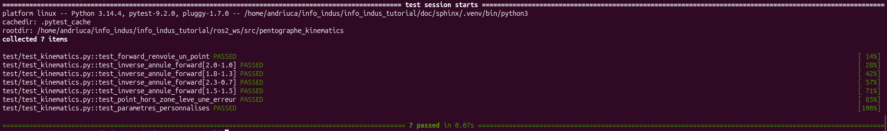

.. _tests:

########################################
 Tests du modèle géométrique
########################################

Le calcul des angles à partir de la position du crayon est la partie la plus
sensible du pilotage : une erreur y fausse tout le dessin. Nous l'avons donc
isolée dans un module Python testable indépendamment de ROS, et couverte par des
tests automatiques.

Pourquoi tester
===============

Les modèles géométriques direct et inverse sont écrits à la main : une faute de
signe ou de longueur ne se voit pas à la lecture, mais fausse tout le dessin.
Les tests vérifient automatiquement que le calcul est correct, sans avoir à
brancher le robot.

Organisation du code
====================

Le package ``pentographe_kinematics`` sépare volontairement deux choses :

* ``kinematics.py`` : les modèles géométriques direct et inverse, en Python pur,
  **sans aucune dépendance à ROS** ;
* ``kinematics_node.py`` : le nœud ROS 2, qui ne fait qu'appeler le module ci-dessus.

Cette séparation permet de tester toutes les mathématiques sans robot, sans
moteurs et sans ROS installé.

Stratégie de test
=================

Les tests se trouvent dans ``test/test_kinematics.py`` et utilisent **pytest**.

.. list-table::
   :header-rows: 1
   :widths: 45 55

   * - Test
     - Ce qu'il vérifie
   * - ``test_forward_renvoie_un_point``
     - le modèle direct renvoie bien une position (x, y)
   * - ``test_inverse_annule_forward``
     - pour plusieurs configurations, le modèle inverse redonne exactement les
       angles de départ : :math:`\text{MGI}(\text{MGD}(q_1, q_4)) = (q_1, q_4)`
   * - ``test_point_hors_zone_leve_une_erreur``
     - un point hors de l'espace de travail lève bien une exception
   * - ``test_parametres_personnalises``
     - les modèles fonctionnent aussi avec d'autres dimensions (valeurs du cours)

Le test le plus important est le second : il garantit que les deux modèles sont
cohérents entre eux. C'est une propriété mathématique sûre, indépendante des
valeurs mesurées.

Lancer les tests
================

Depuis le dossier du package :

.. code-block:: bash

   cd ros2_ws/src/pentographe_kinematics
   python3 -m pytest test/ -v

.. admonition:: Si une erreur ``osrf_pycommon`` apparaît

   Quand ROS 2 est installé, pytest essaie de charger un de ses plugins
   (``launch_testing``) qui peut avoir une dépendance manquante. Nos tests n'en
   ont pas besoin : il suffit de désactiver le chargement automatique des plugins.

   .. code-block:: bash

      PYTEST_DISABLE_PLUGIN_AUTOLOAD=1 python3 -m pytest test/ -v

Résultat attendu : les sept cas de test passent.

   Résultat de l'exécution des tests : 7 passed.

Quand relancer les tests
========================

Les tests doivent être relancés :

* après toute modification de ``kinematics.py`` (équations) ;
* après un changement des dimensions mesurées ;
* avant de committer et d'ouvrir une pull request.

Si un test échoue, c'est que le calcul a été cassé : il faut corriger avant de
continuer.

Fichiers générés et ``.gitignore``
==================================

Certains outils créent des dossiers qui ne doivent **pas** être versionnés :

* ``.pytest_cache/`` : créé par pytest à chaque exécution ;
* ``__pycache__/`` : cache Python ;
* ``build/``, ``install/``, ``log/`` : créés par ``colcon build`` (compilation ROS 2).

Ces dossiers sont listés dans le fichier ``.gitignore`` à la racine du dépôt :
git les ignore donc automatiquement. Si vous ajoutez un outil qui génère de
nouveaux fichiers temporaires, ajoutez-les à ``.gitignore`` plutôt que de les
committer.

.. note::

   À compléter au prochain accès au robot : les tests du nœud ROS 2 lui-même
   (vérifier qu'il publie bien sur ``joint_commands`` quand il reçoit un point
   sur ``pen_target``), à exécuter une fois ROS disponible.
